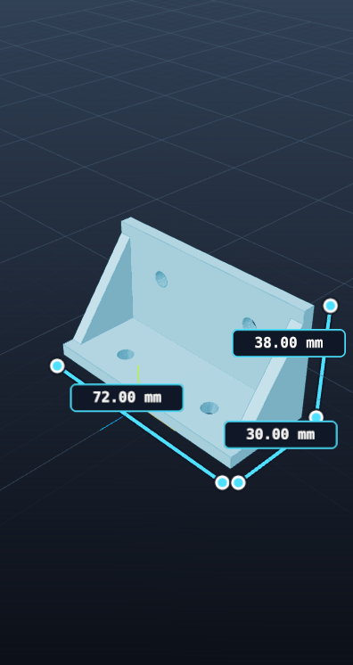

# Forge3D MCP: local modeling tools

Forge3D includes a local [Model Context Protocol (MCP)](https://modelcontextprotocol.io/specification/2025-11-25/basic/transports) stdio server with 15 tools for Design, Assembly, and print-bed preparation. An MCP-compatible client can inspect or edit an unsaved Design buffer, build assemblies from native OpenSCAD renders, arrange parts on a bed, export STL meshes, and receive actual viewport images. Print preparation checks placement and fit; an external slicer is still needed to produce G-code.



The live demo creates a reinforced mounting bracket, changes its width from 64 to 72 mm, and exports a 1,076-triangle native STL. The screenshot above is the viewport image returned by the MCP tool, not a mockup. The demo also exercises stale-edit rejection, atomic parameter validation, quick/final export guards, and recovery after an intentional OpenSCAD parser error.

**Each connection starts a new, visible, isolated Forge3D window. It does not attach to an already-open Forge3D window or read that window's unsaved model.** The MCP window has a fresh temporary user-data directory. Normal settings, recent files, and workspace state are not reused. You can inspect the changes in the MCP window while the client works.

## Trust boundary

**This is a trusted local-code integration, not a filesystem sandbox.** OpenSCAD `include`, `use`, `import`, and `surface` can read files with the application's OS permissions. A fresh app profile does not restrict that access. Connect only clients you trust, review proposed source and tool calls, and do not render untrusted source. If you need stronger isolation, run the entire application under a separate, restricted OS account or an appropriate sandbox.

The server opens no HTTP/TCP listener, creates no API keys, and edits no global MCP configuration. Its only control channel is private, inherited Node IPC from the stdio launcher to its own Electron child. The ordinary desktop app does not expose MCP controls. These tools do not provide arbitrary shell execution, source-file saving, or arbitrary export paths. Forge3D itself does not call an AI provider through this integration; your MCP client controls its own model/provider use.

## Prerequisites and launch

The launcher supports both a **packaged Forge3D app** and a **source checkout**. Both require Node.js 22 or later, native OpenSCAD installed and discoverable by Forge3D for rendering, and a working graphical desktop. The MCP session is a real Electron window, not a headless mesh service.

The launcher waits for MCP JSON on stdin. No terminal prompt or startup text is written to stdout. Electron and OpenSCAD diagnostics go to stderr. It never invokes a shell or automatically adds `--no-sandbox`; run under a normal desktop user with the normal Electron sandbox enabled.

### Installed app with the MCP companion ZIP

1. Install the Forge3D app for your platform and obtain the MCP companion ZIP from the **same release**. Older apps that predate MCP support cannot serve these tools.
2. Extract the companion ZIP to a stable location. Keep its directory layout intact: `package.json` at the root, plus `electron/mcp-server.mjs` and `electron/mcp-protocol.mjs` together in `electron/`. The package metadata supplies the server version.
3. Point `--app` at the **absolute path of the installed native executable**, not a shortcut or a macOS `.app` directory.

Packaged mode needs no source checkout, npm install, Electron npm dependency, or local `dist/` build. It runs the selected app executable directly with no checkout argument, while preserving the same private IPC channel, isolated profile, visible session, and shutdown protections.

Example executable paths (replace them with the actual installation on your machine):

- macOS: `/Applications/Forge3D.app/Contents/MacOS/Forge3D`.
- Windows: `C:\Users\YOU\AppData\Local\Programs\Forge3D\Forge3D.exe`.
- Linux: `/opt/Forge3D/forge3d`, the native executable from an installed or extracted app bundle, not a `.desktop` launcher. Available release packages and desktop runtime dependencies vary by platform.

For example, on macOS:

```sh
node /absolute/path/to/forge3d-mcp/electron/mcp-server.mjs --app "/Applications/Forge3D.app/Contents/MacOS/Forge3D"
```

On Windows PowerShell:

```powershell
node "C:\Tools\forge3d-mcp\electron\mcp-server.mjs" --app "C:\Users\YOU\AppData\Local\Programs\Forge3D\Forge3D.exe"
```

On Linux:

```sh
node /absolute/path/to/forge3d-mcp/electron/mcp-server.mjs --app /opt/Forge3D/forge3d
```

**Mac development preview:** v3.2.0 has an ad-hoc integrity signature but no Apple Developer ID or notarization. Follow [Mac installation](INSTALL-MAC.md) for individual approval. Use only the verified project release, read its platform caveats, and open/approve the app yourself through the OS's normal security UI before connecting a client. The launcher does not remove quarantine, bypass security warnings, change security settings, or make an unsupported platform work automatically. Native rendering still requires OpenSCAD.

### Source checkout

Source mode additionally needs npm 10 or later, project dependencies including Electron, and a built renderer in `dist/`. From the repository root:

```sh
npm install
npm run build
node electron/mcp-server.mjs
```

The convenient npm equivalent is `npm run --silent mcp`. When configuring a client, prefer invoking `node` directly: plain `npm run mcp` may add npm banners to stdout and break stdio framing.

An optional Electron executable override selects the runtime used to open this checkout:

```sh
node electron/mcp-server.mjs --electron /absolute/path/to/electron
```

`--electron` is source mode; `--app` is packaged mode. They are mutually exclusive. Neither mode attaches to an existing Forge3D session. There is no need to start Vite or run `npm run dev`: source mode loads the checkout's built `dist/` renderer, while packaged mode uses the installed app's bundled renderer. Rebuild source changes or update the installed app as appropriate, then reconnect.

## Connect an MCP client

Any MCP harness or provider that supports a local stdio server can launch Forge3D. Its configuration wrapper varies, so use the same `command`, `args`, and optional `env` values in the schema that client documents. Forge3D does not install a provider or change global MCP settings.

The companion includes a helper that generates the common `mcpServers` JSON object. With Node.js 22 or later, run it after installing the app:

```sh
node "/absolute/path/to/forge3d-mcp/electron/mcp-config.mjs" --app "/Applications/Forge3D.app"
```

Pass the absolute path to the macOS `.app` bundle or the installed native executable on Windows or Linux. The helper resolves symlinks and prints the native executable path, server path, and current Node executable as JSON. It does not launch Forge3D or edit client configuration. If native OpenSCAD is installed in a location Forge3D cannot discover, pass its executable path too:

```sh
node "/absolute/path/to/forge3d-mcp/electron/mcp-config.mjs" --app "/Applications/Forge3D.app" --openscad "/absolute/path/to/openscad"
```

This adds `FORGE3D_OPENSCAD_BIN` to the generated entry's `env` object. The helper validates that both supplied paths are absolute executable files.

For clients using an `mcpServers` object, a packaged-app entry has this shape:

```json
{
  "mcpServers": {
    "forge3d": {
      "command": "/absolute/path/to/node",
      "args": [
        "/absolute/path/to/forge3d-mcp/electron/mcp-server.mjs",
        "--app",
        "/absolute/path/to/installed/Forge3D-executable"
      ]
    }
  }
}
```

Use the platform-specific executable path described above. Keep paths with spaces as single array elements; do not add shell quoting inside JSON strings. Windows JSON paths require doubled backslashes.

For a source checkout, omit the `--app` argument and executable path, leaving only the absolute path to that checkout's `electron/mcp-server.mjs` in `args`. This documentation does not install or modify client configuration automatically.

## Available tools

| Tool | Arguments | Result / behavior |
| --- | --- | --- |
| `forge3d_get_model` | `{}` | Reads Design source, filename/path, Design revision, dirty state, mode, editable parameters, render status, and diagnostics. |
| `forge3d_set_code` | `code`, `expectedRevision` | Replaces the active unsaved Design buffer. Requires the current **Design revision**. No source file is saved or overwritten. |
| `forge3d_set_parameters` | `values: [{id, value}]`, `expectedRevision` | Changes supported literal parameters in the unsaved Design buffer. Uses the Design revision and validates the entire edit before applying it. |
| `forge3d_render` | Optional `profile`: `"quick"` or `"final"` | Runs native OpenSCAD against the active Design source and returns render state. Defaults to `"final"`. |
| `forge3d_export_stl` | Optional `filename`, e.g. `"bracket.stl"` | Requires a successful **final** render matching the current Design model. Returns a new file under this session's temporary exports directory. Copy it to durable storage. |
| `forge3d_capture_viewport` | `{}` | Captures the actual current Design or Assembly viewport as PNG image content. Design needs a current render; Assembly needs at least one visible part. |
| `forge3d_set_mode` | `mode: "design"` or `"assembly"` | Switches the visible session between Design and Assembly. Print preparation works on Assembly. |
| `forge3d_get_assembly` | `{}` | Reads part IDs, names, transforms, visibility, geometry bounds, and the **assembly revision**, which is independent of the Design revision. Transforms use viewport Y-up millimeters and XYZ Euler degrees. |
| `forge3d_add_assembly_part` | `code`, optional `name` and `transform`, `expectedRevision` | Renders trusted inline OpenSCAD source with native OpenSCAD and adds the resulting mesh to Assembly. Requires the current assembly revision. Does not save the source to disk. |
| `forge3d_update_assembly_part` | `partId`, `expectedRevision`; optional `name`, `transform`, `visible`, `locked` | Updates an assembly part using the assembly revision. Position is millimeters, rotation is XYZ degrees, and scale components must be positive. |
| `forge3d_duplicate_assembly_part` | `partId`, `instances: [{name, transform}]`, `expectedRevision` | Creates instances of an existing part without rerendering source. Each provided transform is absolute in viewport Y-up coordinates. |
| `forge3d_remove_assembly_part` | `partId`, `expectedRevision` | Removes an unlocked part using the assembly revision. Does not delete source files. |
| `forge3d_export_assembly_stl` | `expectedRevision`; optional `partIds`, `filename` | Exports selected visible assembly meshes (all visible parts by default) and transforms as a new temporary STL. The meshes are combined without boolean union or slicing. Copy the returned file to durable storage. |
| `forge3d_get_print` | Optional `bed: {widthMm, depthMm, heightMm}`, `partIds: [...]` | Checks all visible parts by default or the requested IDs for bed-volume fit, floor contact, and conservative axis-aligned bounding-box (AABB) overlaps. It does not prove exact mesh collision or printability. |
| `forge3d_prepare_print` | `expectedRevision`, required `bed`; optional `partIds`, `spacingMm` | Atomically arranges selected visible unlocked parts in rows on a centered X/Z bed with floor at Y=0. Preserves each part's rotation and scale, rejects parts that cannot fit, and returns updated placement checks. |

The 15 tools are not one shared document revision. Use `forge3d_get_model` for Design edits and `forge3d_get_assembly` for Assembly edits. Each mutation must receive the latest revision for its own mode; read the state again after a stale-revision error. Assembly state can also change from visible UI actions such as selecting a different part, so reread if an edit is rejected. Assembly and bed coordinates are **viewport Y-up**: OpenSCAD/STL `[x, y, z]` maps to viewport `[x, z, -y]`. Source sent to `forge3d_set_code` or `forge3d_add_assembly_part` stays in the temporary session state and is not saved to a `.scad` file. OpenSCAD `include`, `use`, `import`, and `surface` can read local files with the app's OS permissions. Assembly export contains selected visible meshes (all visible meshes by default), including intersections as overlapping geometry; it does not perform a boolean union. If `partIds` selects only part of the assembly during print preparation, pass that same set to assembly export to export that layout. `forge3d_get_print` and `forge3d_prepare_print` only prepare and check bed placement. They do not slice, generate G-code, connect to a printer, create supports, or validate manifold geometry. AABB overlap results are conservative warnings, not exact collision tests.

Ordinary model results contain JSON encoded in an MCP text content item. The viewport result uses `{"type":"image","mimeType":"image/png","data":"...base64..."}`. Clients should display or save that image content using their normal MCP support.

Only model inspection and viewport capture advertise `readOnlyHint: true`. Other tools carry conservative mutation/destruction annotations; these hints are not substitutes for client permissions or review.

### Revisions and parameters

Always get the current model before editing. Pass the returned `revision` as `expectedRevision`; if the model changes in the UI or through another call, an old revision fails instead of overwriting newer work. Read again and reassess the edit. Do not blindly retry stale edits. Reading the model is allowed while a render is running, but editing is not.

The parameter list contains safely editable, top-level number, string, and boolean literal assignments, with annotation metadata where present. Derived expressions, vectors, nested variables, and commented-out assignments are not presented as editable parameters. Use the exact returned parameter `id`; IDs include source line identity and can change when source lines move. Numeric ranges and enum options are checked, and string values are encoded as literals rather than interpolated as code.

After a source or parameter edit, explicitly render again. A failed render, a changed model, or a non-final render cannot be exported as the current final STL. Tools that edit, render, or export operate in Design mode; they fail if the user has switched to another mode.

### Export ownership and durability

`filename` is a basename ending in `.stl`, at most 200 UTF-8 bytes. Paths, directory separators, control characters, and reserved filename characters are rejected. The app chooses a unique prefixed filename under the session's temporary `exports` directory and uses exclusive creation, so an existing file is never overwritten.

Export uses the successful native OpenSCAD STL bytes, not a reconstruction of whatever happens to be visible. Copy the returned file to your chosen durable location before relying on it: the output and isolated session profile live in the OS temporary directory and may be cleaned up by the OS. The tools do not promise permanent storage or automatically save the edited `.scad` source. The isolated app may autosave its editor state inside its temporary profile, not into the normal app's profile or the source file.

## A complete demonstration

Once connected, ask the client:

> In the isolated Forge3D session, read the current model, replace the unsaved source with a parameterized 30 × 20 × 4 mm plate with a centered 6 mm hole, render it at final quality, show me the actual viewport capture, and export a new STL named plate.stl. Do not overwrite a source file.

A correct tool sequence is:

1. `forge3d_get_model` to learn the current revision.
2. `forge3d_set_code` with that revision and trusted source such as:

   ```scad
   width = 30;
   depth = 20;
   thickness = 4;
   hole_diameter = 6;
   difference() {
     cube([width, depth, thickness], center=true);
     cylinder(h=thickness + 2, d=hole_diameter, center=true, $fn=64);
   }
   ```

3. `forge3d_render` with `{"profile":"final"}`. Check `isError` and the returned diagnostics/current-render status.
4. `forge3d_capture_viewport` and display its image content.
5. `forge3d_export_stl` with `{"filename":"plate.stl"}` and report the actual returned path.
6. To demonstrate a parameter edit, read the latest model, locate the returned `width` parameter ID, call `forge3d_set_parameters` with its current revision and a new width, then render and capture again. The previous render must not be exported after the edit.

The initial revision is session-specific; do not assume it is zero or hard-code parameter IDs in a reusable client.

## Assembly and print-bed preparation example

Assembly tools build on native OpenSCAD meshes, then position those meshes in the visible Assembly viewport. Switch to Assembly, read its revision, and add a base plate from trusted inline source:

```json
{"mode":"assembly"}
```

```json
{"expectedRevision":0,"name":"Base plate","code":"cube([80, 50, 4], center=true);"}
```

The revision above is only an illustration. Call `forge3d_get_assembly` first and use its returned `revision`; then use each mutation's returned assembly `revision` for the next `expectedRevision`. Save the returned `addedPartId` values to address parts later. In this example, add one post and duplicate it into a four-corner set:

```json
{"expectedRevision":1,"name":"Corner post","code":"cylinder(h=18, d=8, $fn=48);","transform":{"position":[32,0,17]}}
```

Use the returned post ID and latest assembly revision:

```json
{"expectedRevision":2,"partId":"RETURNED_POST_ID","instances":[
  {"name":"Post left front","transform":{"position":[-32,0,17]}},
  {"name":"Post right back","transform":{"position":[32,0,-17]}},
  {"name":"Post left back","transform":{"position":[-32,0,-17]}}
]}
```

The numbers above demonstrate argument shape only; real revision numbers and part IDs come from tool results. Source geometry uses OpenSCAD's Z-up coordinates. Assembly transforms use viewport Y-up coordinates in millimeters, with OpenSCAD `[x, y, z]` mapping to viewport `[x, z, -y]`. Thus the base plate's OpenSCAD XY plane becomes the assembly XZ bed plane, and the cylinder's OpenSCAD Z axis becomes vertical Y. Each `forge3d_add_assembly_part` renders its inline source into a mesh; Forge3D does not save that source as a `.scad` file.

Check the selected parts against the printer's actual bed dimensions, then arrange them:

```json
{"bed":{"widthMm":220,"depthMm":220,"heightMm":250}}
```

```json
{"expectedRevision":3,"bed":{"widthMm":220,"depthMm":220,"heightMm":250},"spacingMm":4}
```

`forge3d_get_print` reports bed-volume fit, floor contact, and AABB overlaps for all visible parts by default, or the supplied `partIds`. `forge3d_prepare_print` arranges all visible parts by default, preserving their rotation and scale. Pass `partIds` to choose a subset. It requires explicit bed dimensions, rejects hidden or locked selected parts, and applies no position changes if a part cannot fit. Read the resulting assembly revision from its response, call `forge3d_get_print` again to inspect placement, and use `forge3d_capture_viewport` to see the current visible Assembly layout.

Finally, export the visible assembly meshes for use in an external slicer:

```json
{"expectedRevision":4,"filename":"bracket-assembly.stl"}
```

Use the current assembly revision returned after preparation; the example assumes an empty assembly starting at revision zero and is illustrative. Assembly STL applies the visible part transforms and converts back to OpenSCAD/STL Z-up coordinates. It combines meshes into one STL file but does not boolean-union overlapping parts. If you prepared only a subset with `partIds`, pass that same list to `forge3d_export_assembly_stl`; otherwise the export includes every visible part. Print preparation checks bed layout and conservative AABB overlaps only. It does not slice, generate G-code, control a printer, add supports, or verify exact mesh intersections or manifold quality. Both Design and Assembly exports are created under the isolated session's temporary exports directory; copy any file you need to keep to durable storage before the session or temporary files are removed.

## Reproducible source-checkout desktop smoke test

With a source checkout, a built renderer, a graphical desktop, and native OpenSCAD available, run:

```sh
node scripts/mcp-demo.mjs --output /absolute/path/to/a/new-demo-directory
```

Add `--keep-open` to leave the completed model visible until Ctrl+C. Without it, the script closes the MCP connection and verifies shutdown. The default output directory is `output/mcp-demo`; **the demo script writes fixed artifact names and can overwrite prior demo artifacts there**, so choose a new output directory when preserving previous runs matters. This is separate from the MCP STL tool's non-overwriting temporary exports.

The script acts as an actual stdio MCP client. It discovers all six tools, edits and resizes a reinforced mounting bracket to 72 × 30 × 38 mm, performs native quick/final renders, rejects stale revisions and invalid/partial parameter edits, checks export/path protections, deliberately triggers a native syntax failure, and recovers to a valid final model. It saves:

- `mounting-bracket.scad`, `mounting-bracket.stl`, and the actual `mounting-bracket.png` viewport capture.
- `report.json` with checks, model bounds, and result status.
- `transcript.json` with MCP requests/responses (image data abbreviated), plus `electron.log`.
- `shutdown.json` after the session exits.

Inspect the image and mesh as well as the report. A successful protocol-only unit test is not a substitute for this native desktop run.

## Protocol and lifecycle

- Transport: newline-delimited UTF-8 JSON-RPC 2.0 over stdin/stdout. No LSP `Content-Length` framing. Embedded newlines in source are JSON-escaped.
- Supported protocol versions: `2024-11-05`, `2025-03-26`, `2025-06-18`, and `2025-11-25`. An unknown version is negotiated to `2025-11-25`; the client decides whether it supports that version.
- Lifecycle: send `initialize` with `protocolVersion`, `capabilities`, and `clientInfo`; wait for its response, then send `notifications/initialized`. `ping`, `tools/list`, and `tools/call` are supported. No resources, prompts, subscriptions, sampling, or MCP tasks are advertised.
- JSON-RPC batches are supported only for an initialized `2025-03-26` session, the revision that specified them. Initialization is never batched; later revisions use individual messages.
- Malformed JSON, invalid request shapes, unknown methods/tools, and lifecycle errors use JSON-RPC errors. Known-tool validation or execution failures use MCP tool results with `isError: true`, so the client can correct the request.
- Source input is limited to 2 MiB UTF-8; an input frame is limited to 4 MiB. A session admits at most 32 pending calls. Main processes model calls serially so edits and renders do not race each other.
- Electron must report renderer readiness within 60 seconds. Each tool call has a six-minute maximum including queued time. Native rendering and renderer requests have their own shorter bounds.
- On a call timeout the session closes, rather than allowing a late queued mutation to run after a retry. A timed-out operation may already have completed; reconnect and inspect before retrying.
- Closing client stdin ends the session. The launcher asks Electron to quit and clean up active native work, then falls back to `SIGTERM` and `SIGKILL` if it does not exit. Closing/reloading the MCP window, an IPC disconnect, or a child crash also ends the session. An existing ordinary Forge3D window is unaffected.
- This implementation does not offer per-call cancellation. Close the MCP connection to terminate the whole session. Notification messages never execute model tools.

The framing and lifecycle follow the official [transport](https://modelcontextprotocol.io/specification/2025-11-25/basic/transports), [lifecycle](https://modelcontextprotocol.io/specification/2025-11-25/basic/lifecycle), and [tool](https://modelcontextprotocol.io/specification/2025-11-25/server/tools) specifications.

## Troubleshooting and verification

- **Renderer build not found:** in source mode, run `npm run build` in the checkout and reconnect. For an installed app, use `--app` with its absolute executable path; do not build or install dependencies into the companion directory.
- **Electron does not become ready:** inspect the client's captured stderr. Confirm graphical desktop access and sandbox support. In source mode, check dependencies and the renderer build. In packaged mode, use the matching app/companion release, verify the native executable path, and open the app yourself first if OS approval is needed. Do not work around this by disabling the sandbox.
- **Packaged executable not found or is a directory:** use the actual binary, including `Contents/MacOS/Forge3D` inside a macOS app bundle; never pass the `.app` directory, a Windows shortcut, or a Linux `.desktop` file. `--app` requires an absolute path.
- **OpenSCAD missing or render failure:** inspect the tool's diagnostics and configure/install the native OpenSCAD executable using the normal Forge3D workflow. Startup alone does not prove a native renderer is available.
- **Model changed:** read `forge3d_get_model` and use its current revision. Keep the human's newer edits.
- **No current final render:** render at `"final"` after the last edit, then export.
- **Viewport not drawing:** restore the visible MCP window and retry capture. A minimized/background window may suspend drawing; the tool fails rather than returning a made-up image.
- **Invalid protocol output:** configure `node` directly, not a noisy shell/npm wrapper. All stdout lines must be JSON; stderr logs are expected.

Run transport/protocol checks with:

```sh
node --check electron/mcp-protocol.mjs
node --check electron/mcp-server.mjs
node --test scripts/mcp-protocol.test.mjs scripts/mcp-bridge.test.mjs
npm run test:node
npm run build
```

The focused tests cover framing, lifecycle/version negotiation, schemas, revision argument checks, error envelopes, IPC correlation, timeouts, shutdown, a real Node child-process IPC round trip, and a dependency-free companion-layout packaged-mode fixture. That process fixture is **not** an Electron/OpenSCAD end-to-end test. Before claiming native modeling works on a platform, run the demonstration in a real graphical Electron session with native OpenSCAD and inspect the captured image and exported mesh.
